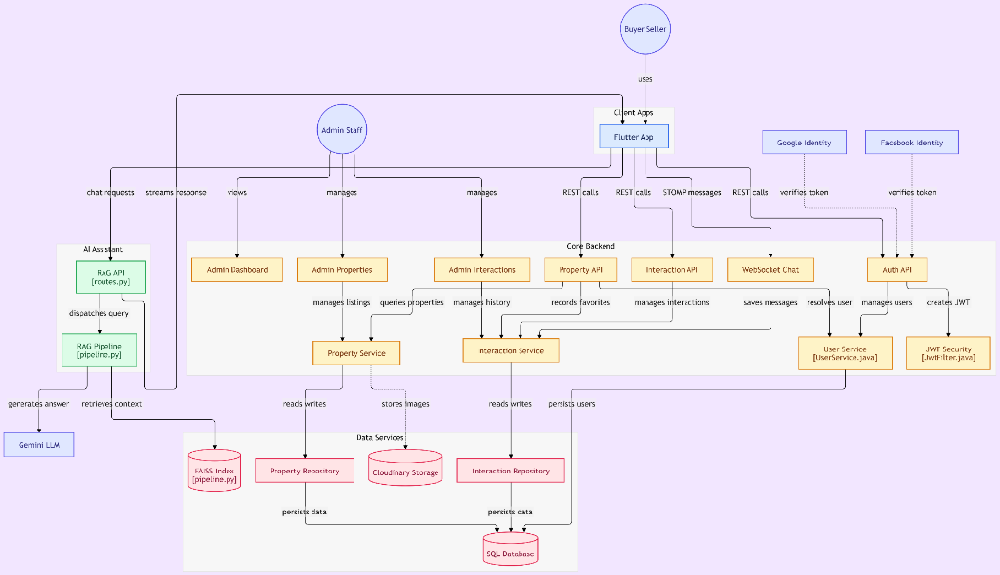

<div align="center">

# 🏡 HỆ THỐNG QUẢN LÝ BẤT ĐỘNG SẢN ĐA NỀN TẢNG TÍCH HỢP TƯ VẤN THÔNG MINH
### Nền Tảng Công Nghệ Bất Động Sản Toàn Diện Tích Hợp Trợ Lý Ảo AI & Chat Thời Gian Thực

[](https://flutter.dev)
[](https://dart.dev)
[](https://spring.io/projects/spring-boot)
[](https://www.oracle.com/java/)
[](https://fastapi.tiangolo.com)
[](https://www.python.org)
[](https://www.langchain.com)
[](https://supabase.com)
[](https://www.mysql.com/)
[](https://railway.app)
[](https://play.google.com)

</div>

---

## 📖 1. Giới Thiệu Dự Án

Tài liệu chatbot hiện hành ghi lại luồng Gemini, Qdrant, PostgreSQL, RabbitMQ và SSE v2 trên web. Xem [triển khai và benchmark chatbot](docs/frontend/CHATBOT_WEB_IMPROVEMENTS.md) và [bàn giao Flutter](docs/handoffs/CHATBOT_MOBILE_HANDOFF.md).

**Hệ Thống Quản Lý Bất Động Sản Đa Nền Tảng Tích Hợp Tư Vấn Thông Minh** là giải pháp nền tảng công nghệ bất động sản toàn diện (**PropTech Platform**) hiện đại, kết nối trực tiếp giữa người có nhu cầu mua bán/thuê bất động sản và môi giới/chủ sở hữu. Hệ thống được xây dựng trên kiến trúc hướng dịch vụ (**Microservices / Modular Distributed Architecture**) gồm:

1. **Ứng dụng di động đa nền tảng (Flutter)**: Giao diện Material 3 mượt mà, tối ưu hóa trải nghiệm tìm kiếm, quản lý bài đăng và tích hợp trợ lý ảo thông minh.
2. **Ứng dụng web Nhà Thật (React + TypeScript + Vite)**: Mở rộng hệ thống sang trình duyệt với chức năng tìm kiếm, lưu tin, đăng tin và trợ lý AI. Web dùng chung API nghiệp vụ với ứng dụng Flutter.
3. **Hệ thống dịch vụ lõi (Spring Boot Core Backend)**: Quản trị tài khoản, danh mục bất động sản, phân quyền JWT, tương tác dữ liệu và hệ thống tin nhắn **WebSocket STOMP** thời gian thực.
4. **Trung tâm trí tuệ nhân tạo (FastAPI + LangChain + FAISS + Gemini LLM)**: Trợ lý tư vấn bất động sản thông minh theo kỹ thuật **RAG (Retrieval-Augmented Generation)**, streaming câu trả lời theo thời gian thực (Server-Sent Events).
5. **Cơ sở dữ liệu linh hoạt**: Tương thích cả **MySQL** (môi trường Local Dev) và **PostgreSQL Supabase Cloud** (môi trường Live Production).

---

## 🚀 2. Điểm Nhấn Công Nghệ & Trạng Thái Triển Khai

| Thành phần | Công nghệ chính | Trạng thái triển khai | Địa chỉ Live / Kênh phân phối |
| :--- | :--- | :---: | :--- |
| **Web App Nhà Thật** | React, TypeScript, Vite, React Router, Leaflet, SSE v2 | Đã tích hợp trong mã nguồn | [Frontend web](real_estate_frontend-web/) |
| **Mobile App** | Flutter 3.24+, Dart, Material 3, Android App Bundle | ✅ Đã phát hành | Google Play Store (`com.ndnt.realestate`) |
| **Core Backend** | Spring Boot 3.x, Java 21, Spring Security, JWT, JPA, WebSocket STOMP | ✅ Đang chạy 24/7 | Railway |
| **AI RAG Service** | Python 3.10+, FastAPI, LangChain, FAISS Vector DB, Google Gemini LLM | ✅ Đang chạy 24/7 | Railway |
| **Cơ sở dữ liệu** | PostgreSQL Cloud (Supabase) / MySQL Local, Cloudinary Image Storage | ✅ Đang chạy 24/7 | Supabase Cloud Database & Cloudinary CDN |

---

## 🏛️ 3. Kiến Trúc Toàn Hệ Thống

<div align="center">
  
  <p><em>Hình 1: Sơ đồ kiến trúc tổng thể toàn diện của hệ thống (Actors, Client Apps, AI Assistant, Core Backend, Data Services & Identity Providers).</em></p>
</div>

### Chi Tiết Các Khối Phân Hệ Trong Kiến Trúc

| Phân hệ / Khối | Thành phần chi tiết | Công nghệ & Tập tin chính | Vai trò & Trách nhiệm |
| :--- | :--- | :--- | :--- |
| **Client Apps** | Web App Nhà Thật | React, TypeScript, Vite, React Router, Leaflet | Gọi REST API của Spring Boot cho nghiệp vụ và nhận phản hồi chatbot từ FastAPI qua SSE v2. |
| **Client Apps** | `Flutter App` | Flutter 3.24+, Dart, Material 3 | Ứng dụng di động phục vụ Người Mua / Người Bán (`Buyer Seller`), gọi REST API, gửi nhận STOMP messages qua WebSocket và giao tiếp SSE streaming với AI. |
| **External Services** | `Google / Facebook Identity`, `Gemini LLM` | Google OAuth 2.0, Facebook Graph API, Google Gemini AI | Xác thực token người dùng không cần mật khẩu; sinh câu trả lời tự nhiên thông minh từ tri thức chuyên sâu BĐS. |
| **AI Assistant** | `RAG API`, `RAG Pipeline` | FastAPI, LangChain, FAISS, Python (`routes.py`, `pipeline.py`) | Tiếp nhận truy vấn tư vấn pháp lý / định giá, trích xuất ngữ cảnh liên quan từ vector store FAISS và streaming kết quả về di động. |
| **Core Backend** | `Admin Dashboard`, `Admin Properties`, `Admin Interactions` | Spring MVC, Thymeleaf | Giao diện và API dành cho `Admin Staff` theo dõi dữ liệu, kiểm duyệt tin đăng và quản lý lịch sử tương tác. |
| **Core Backend** | `Property API`, `Interaction API`, `WebSocket Chat`, `Auth API` | Spring Boot REST Controller, WebSocket STOMP Message Broker | Xử lý các nghiệp vụ cốt lõi: đăng bài, lọc tin, ghi nhận tin yêu thích, nhắn tin trực tiếp 1-1 và xác thực tài khoản. |
| **Service Layer** | `Property Service`, `Interaction Service`, `User Service`, `JWT Security` | Spring Data JPA Service, `JwtFilter.java`, `UserService.java` | Hiện thực hóa nghiệp vụ nghiệp vụ, điều phối đọc/ghi cơ sở dữ liệu, phân quyền tài khoản và cấp phát JWT Token. |
| **Data Services** | `FAISS Index`, `Property Repo`, `Interaction Repo`, `Cloudinary`, `SQL Database` | FAISS (`index.faiss`), Spring Data JPA, Cloudinary CDN, MySQL / PostgreSQL | Lưu trữ vector ngữ cảnh, kho hình ảnh bất động sản và cơ sở dữ liệu quan hệ lưu trữ dữ liệu vĩnh viễn (users, properties, interactions). |

---

## ✨ 4. Các Tính Năng Nổi Bật

### 4.1. Ứng Dụng Di Động (Flutter)
- **Tìm kiếm & Bộ lọc BĐS chuyên sâu**: Lọc theo khu vực (Tỉnh/Thành phố, Quận/Huyện, Phường/Xã), khoảng giá, diện tích, phân loại (nhà riêng, căn hộ, biệt thự, đất nền, phòng trọ...).
- **Chi tiết Bất Động Sản sắc nét**: Slider trình diễn hình ảnh chất lượng cao (tích hợp Cloudinary), thông số chi tiết (pháp lý, hướng nhà, số phòng), vị trí và nút liên hệ nhanh người bán.
- **Trợ lý ảo AI tư vấn (AI Floating Chat)**: Cửa sổ chat nổi trực tiếp trên màn hình, hỗ trợ streaming từng chữ phản hồi theo thời gian thực (SSE), giải đáp pháp lý và định giá thị trường.
- **Nhắn tin thời gian thực 1-1 (Live Chat)**: Kết nối trực tiếp giữa khách hàng và người bán bằng giao thức WebSocket STOMP.
- **Xác thực linh hoạt**: Hỗ trợ đăng nhập truyền thống (JWT), đăng nhập nhanh bằng **Google Sign-In** hoặc **Facebook Login**.
- **Đăng tin & Quản lý bài đăng**: Dành cho người bán/môi giới với tính năng upload ảnh từ thư viện/camera, quản lý khách hàng quan tâm (`SellerOverview`, `SellerProperties`, `SellerCustomers`).
- **Lưu tin yêu thích & Lịch sử tương tác**: Quản lý tin BĐS quan tâm, hỗ trợ liên hệ lại bất cứ lúc nào.
- **Chuyển đổi môi trường thông minh (`AppConfig.dart`)**: Tự động nhận biết môi trường máy ảo Android Emulator (`10.0.2.2`) khi Debug hoặc chuyển sang Live Server Railway khi Build Production.

### 4.2. Ứng Dụng Web Nhà Thật (React)

- **Khám phá bất động sản**: Duyệt và lọc tin mua hoặc thuê. Người dùng đăng nhập có thể xem ảnh, thông số và vị trí trên bản đồ Leaflet, lưu tin quan tâm và quản lý hồ sơ.
- **Quản lý tin đăng**: Đăng tin kèm ảnh, xem danh sách phân trang và theo dõi xét duyệt. Chủ tin có thể đọc lý do từ chối, lưu chỉnh sửa và gửi lại tin để xét duyệt.
- **Trợ lý AI trên trình duyệt**: Nhận câu trả lời từng phần qua SSE v2, hiển thị thẻ bất động sản và hỗ trợ câu hỏi nối tiếp như *“Cho tôi biết thêm về tin thứ hai”*. Người dùng có thể dừng phản hồi đang chạy.
- **Phạm vi tích hợp**: Các màn hình khôi phục mật khẩu, tin nhắn và khách hàng quan tâm trên web đang chờ kết nối nghiệp vụ.

[Chạy frontend web cục bộ](real_estate_frontend-web/README.md#chạy-local) · [Tích hợp và benchmark chatbot web](docs/frontend/CHATBOT_WEB_IMPROVEMENTS.md)

### 4.3. Hệ Thống Dịch Vụ Lõi (Spring Boot)
- **Kiến trúc phân tầng chuẩn mực**: Tách biệt rõ rệt `Controller`, `Service`, `Repository`, `Entity`, `DTO` và `Converter`.
- **Hệ thống bảo mật đa tầng**: Cấu hình Spring Security với cơ chế JWT Stateless Authentication, phân quyền vai trò (Role-Based Access Control).
- **Trang quản trị Admin Web**: Tích hợp sẵn Thymeleaf quản lý người dùng, danh mục, khu vực địa lý và bài đăng trực tiếp trên trình duyệt.
- **Đồng bộ hóa tin nhắn**: Xử lý hàng đợi tin nhắn WebSocket và lưu vết lịch sử tương tác khách hàng.
- **Hỗ trợ đa cơ sở dữ liệu**: Dễ dàng chuyển đổi giữa MySQL (chạy local) và PostgreSQL Supabase (chạy production) chỉ qua profile cấu hình.

### 4.4. Dịch Vụ Trí Tuệ Nhân Tạo (FastAPI & LangChain)
- **Kỹ thuật RAG tiên tiến**: Kết hợp Vector Search (FAISS) với kiến thức pháp lý và dữ liệu BĐS Việt Nam để giảm thiểu tối đa hiện tượng ảo giác (hallucination) của mô hình ngôn ngữ lớn.
- **Phản hồi Streaming cực nhanh**: Giảm thời gian chờ phản hồi đầu tiên (Time-to-First-Token) xuống dưới 1 giây.
- **Cơ sở dữ liệu Vector nhúng sẵn**: Lưu trữ sẵn trong `vector_database/` (bao gồm `index.faiss`, `docstore.pkl`, `index.pkl`), không cần build lại index từ đầu khi clone về.

---

## 📁 5. Cấu trúc repository

```text
RealEstateMobile-Project/
├── real_estate_frontend-web/      # Web Nhà Thật bằng React
├── real_estate_frontend-mobile/   # Ứng dụng di động bằng Flutter
├── real-estate-backend/           # REST API, WebSocket và trang quản trị
├── real-estate-ai/                # API chatbot RAG và worker lập chỉ mục
└── docs/                         # Kiến trúc, tích hợp và bàn giao
```

[Web](real_estate_frontend-web/) · [Mobile](real_estate_frontend-mobile/) · [Backend](real-estate-backend/) · [Chatbot AI](real-estate-ai/) · [Tài liệu](docs/)

---

## 🛠️ 6. Hướng Dẫn Cài Đặt & Chạy Cục Bộ (Local Testing Guide)

Khi một thành viên mới clone repository này về máy tính cá nhân để phát triển hoặc kiểm thử (test), bạn có thể lựa chọn **1 trong 2 kịch bản**:

- **Kịch bản 1 (Khuyên dùng nếu chỉ muốn test nhanh giao diện Mobile App)**: Kết nối trực tiếp vào Backend & AI đã được tác giả triển khai sẵn trên Cloud Railway (chỉ mất 2 phút cài Flutter).
- **Kịch bản 2 (Chạy Full-Stack Cục Bộ từ A đến Z)**: Khởi chạy toàn bộ Database, Spring Boot, Python FastAPI và Flutter trên chính máy tính của bạn.

---

### 🌟 KỊCH BẢN 1: Quick Start - Test Nhanh Mobile App (Không Cần Cài Backend & DB)

Backend và AI Service của dự án đã được deploy sẵn trên hạ tầng Railway và hoạt động ổn định 24/7. Bạn có thể kiểm thử ngay ứng dụng di động:

```bash
# 1. Clone repository về máy
git clone https://github.com/NhatTruong1905/RealEstateMobile-Project.git
cd RealEstateMobile-Project/real_estate_frontend

# 2. Cài đặt thư viện Flutter
flutter pub get

# 3. Khởi chạy ứng dụng và trỏ vào Server Production Cloud
flutter run --dart-define=ENV=prod
```

> [!TIP]
> Nếu bạn sử dụng **Visual Studio Code**, chỉ cần mở thư mục dự án, nhấn phím **F5**, sau đó chọn cấu hình:
> **`Flutter: Chạy Deploy (Prod - Railway)`** từ menu danh sách. Ứng dụng sẽ tự khởi chạy trên máy ảo hoặc thiết bị kết nối.

---

### 💻 KỊCH BẢN 2: Khởi Chạy Toàn Bộ Hệ Thống Cục Bộ (Full-Stack Local)

#### 📋 Yêu Cầu Môi Trường Tiên Quyết
Đảm bảo máy tính của bạn đã cài đặt các công cụ sau:
- **Git** (để clone mã nguồn).
- **Java Development Kit (JDK)**: Phiên bản **Java 21** (khuyên dùng) hoặc tối thiểu **Java 17**.
- **Python**: Phiên bản **3.10** đến **3.12** kèm `pip`.
- **Cơ sở dữ liệu**: Cài đặt **MySQL 8.0+** (hoặc chuẩn bị tài khoản PostgreSQL miễn phí tại [Supabase](https://supabase.com)).
- **Flutter SDK**: Phiên bản **3.24+** (đã thiết lập môi trường Android Studio, Android SDK và Android Emulator).

---

#### 🔹 BƯỚC 1: Cấu Hình Cơ Sở Dữ Liệu (Database Setup)

##### Lựa chọn 1: Dùng MySQL Cục Bộ (Mặc định cho Dev)
1. Khởi động MySQL Server của bạn (cổng mặc định `3306`).
2. Mở công cụ quản lý cơ sở dữ liệu (như MySQL Workbench, DBeaver hoặc Terminal) và tạo database mới:
   ```sql
   CREATE DATABASE realestate_db CHARACTER SET utf8mb4 COLLATE utf8mb4_unicode_ci;
   ```
3. Mở file [application.properties](file:///d:/RealEstateMobile-Project/real-estate-backend/src/main/resources/application.properties) trong `real-estate-backend/src/main/resources/` và điều chỉnh thông số cho khớp với tài khoản MySQL của bạn:
   ```properties
   spring.datasource.driver-class-name=com.mysql.cj.jdbc.Driver
   spring.datasource.url=jdbc:mysql://localhost:3306/realestate_db
   spring.datasource.username=root
   spring.datasource.password=root@123
   ```
   *(Mẹo: Nếu muốn Hibernate tự động sinh toàn bộ bảng trong lần khởi chạy đầu tiên, bạn có thể tạm thời đổi dòng `spring.jpa.hibernate.ddl-auto=none` thành `spring.jpa.hibernate.ddl-auto=update`).*

##### Lựa chọn 2: Dùng PostgreSQL Supabase Cloud
Nếu bạn muốn dùng cơ sở dữ liệu trên đám mây của Supabase, bạn chỉ cần cấu hình chuỗi kết nối trong `application.properties`:
```properties
spring.datasource.url=jdbc:postgresql://<supabase-host>:5432/<dbname>
spring.datasource.username=postgres
spring.datasource.password=<supabase-db-password>
spring.datasource.driver-class-name=org.postgresql.Driver
```

---

#### 🔹 BƯỚC 2: Khởi Chạy Core Backend (Spring Boot)

1. Mở cửa sổ dòng lệnh tại thư mục backend:
   ```bash
   cd RealEstateMobile-Project/real-estate-backend
   ```
2. Kiểm tra file `src/main/resources/application-secret.properties`. File này đã được thiết lập sẵn các khóa bí mật mặc định phục vụ chạy thử:
   - Khóa ký JWT: `JWT_SECRET`
   - Gemini API Key: `spring.ai.openai.api-key`
   - Google / Facebook OAuth credentials.
3. Khởi chạy server bằng **Maven Wrapper** đi kèm sẵn trong dự án:
   - **Trên Windows (PowerShell / Command Prompt)**:
     ```powershell
     .\mvnw.cmd spring-boot:run
     ```
   - **Trên Linux / macOS**:
     ```bash
     chmod +x mvnw
     ./mvnw spring-boot:run
     ```
4. **Kiểm tra trạng thái Backend**:
   - Mở trình duyệt truy cập: `http://localhost:8080/api/properties`
   - Nếu nhận về kết quả JSON trạng thái `200 OK` (hoặc mảng bài đăng rỗng `[]`), backend đã khởi động thành công!
   - Bạn cũng có thể truy cập trang quản trị web admin tại: `http://localhost:8080/`

---

#### 🔹 BƯỚC 3: Khởi Chạy Trí Tuệ Nhân Tạo AI Service (FastAPI)

1. Mở cửa sổ dòng lệnh mới tại thư mục AI:
   ```bash
   cd RealEstateMobile-Project/real-estate-ai
   ```
2. Tạo và kích hoạt môi trường ảo Python (**Virtual Environment**):
   - **Trên Windows**:
     ```powershell
     python -m venv .venv
     .\.venv\Scripts\activate
     ```
   - **Trên Linux / macOS**:
     ```bash
     python3 -m venv .venv
     source .venv/bin/activate
     ```
3. Cài đặt toàn bộ các thư viện cần thiết:
   ```bash
   pip install -r requirements.txt
   ```
4. Thiết lập file biến môi trường `.env`:
   Tạo file mang tên `.env` trong thư mục `real-estate-ai/` và điền Google Gemini API Key của bạn:
   ```env
   GOOGLE_API_KEY=your_gemini_api_key_here
   ```
   > [!NOTE]
   > Bạn có thể tạo **Google Gemini API Key hoàn toàn miễn phí** chỉ với tài khoản Google tại: [Google AI Studio](https://aistudio.google.com/).
5. Khởi chạy máy chủ FastAPI bằng Uvicorn:
   ```bash
   uvicorn main:app --host 0.0.0.0 --port 8000 --reload
   ```
6. **Kiểm tra trạng thái AI Service**:
   - Mở trình duyệt truy cập: `http://localhost:8000/docs`
   - Bạn sẽ thấy giao diện Swagger UI tương tác với endpoint `/api/ask`. Vì Vector Database (`vector_database/`) đã được đính kèm sẵn trong repo, dịch vụ AI có thể trả lời các câu hỏi về bất động sản ngay tức khắc!

---

#### 🔹 BƯỚC 4: Khởi Chạy Ứng Dụng Di Động (Flutter Frontend)

##### 1. Hiểu Về Cơ Chế Mạng Khi Chạy Local (`AppConfig.dart`)
Tệp [AppConfig.dart](file:///d:/RealEstateMobile-Project/real_estate_frontend/lib/config/AppConfig.dart) được thiết lập tự động:
- **Khi chạy trên Android Emulator (Máy ảo Android Studio)**: Máy ảo sử dụng địa chỉ đặc biệt `10.0.2.2` để truy cập vào cổng `localhost` của máy tính. Vì vậy, mặc định `AppConfig.dart` trỏ sẵn đến `http://10.0.2.2:8080` (Spring Boot) và `http://10.0.2.2:8000` (FastAPI AI). **Bạn không cần chỉnh sửa bất kỳ dòng code nào khi chạy với Android Emulator!**
- **Khi chạy trên Điện Thoại Thật (Cắm cáp USB hoặc Wi-Fi Debugging)**: Điện thoại thật không thể hiểu địa chỉ `10.0.2.2`. Bạn hãy mở [AppConfig.dart](file:///d:/RealEstateMobile-Project/real_estate_frontend/lib/config/AppConfig.dart) và sửa biến:
  ```dart
  // Thay 192.168.x.x bằng IP LAN của máy tính bạn (xem bằng lệnh ipconfig hoặc ifconfig)
  static const String _springBootLocalHost = '192.168.1.15:8080';
  static const String _aiLocalHost = '192.168.1.15:8000';
  ```
  *(Đảm bảo điện thoại và máy tính cùng kết nối chung một mạng Wi-Fi).*

##### 2. Lệnh Khởi Chạy Ứng Dụng
1. Mở cửa sổ dòng lệnh tại thư mục frontend:
   ```bash
   cd RealEstateMobile-Project/real_estate_frontend
   ```
2. Kiểm tra danh sách thiết bị/máy ảo đang kết nối:
   ```bash
   flutter devices
   ```
3. Lấy dependencies:
   ```bash
   flutter pub get
   ```
4. Khởi chạy ứng dụng (mặc định môi trường Dev Local):
   ```bash
   flutter run
   ```
5. *(Tùy chọn)* Nếu sử dụng **VS Code**, bạn chỉ việc nhấn **F5** và chọn:
   **`Flutter: Chạy Local (Dev - 10.0.2.2)`**.

---

## ⚙️ 7. Bảng Tổng Hợp Tham Số Cấu Hình Hệ Thống

### Backend Configuration (`real-estate-backend/src/main/resources/`)
| Tên File | Tham Số Chính | Chức năng |
| :--- | :--- | :--- |
| `application.properties` | `server.port=8080`<br>`spring.datasource.url`<br>`spring.jpa.hibernate.ddl-auto` | Cổng dịch vụ backend, thông tin kết nối MySQL/PostgreSQL và chế độ tự sinh schema JPA. |
| `application-secret.properties` | `JWT_SECRET`<br>`spring.ai.openai.api-key`<br>`GOOGLE_CLIENT_ID`<br>`FACEBOOK_APP_ID` | Chìa khóa mã hóa JWT, API key Gemini (qua OpenAI format) và OAuth Client IDs. |
| Biến môi trường backend | `RESEND_API_KEY`, `RESEND_FROM`, `PROPERTY_MAIL_WORKER_ENABLED` | [Cấu hình email qua Resend](docs/integrations/RESEND_EMAIL_SETUP.md). |
| `application-prod.properties` | `spring.datasource.url=${DATABASE_URL}` | Cấu hình nhận biến môi trường khi deploy lên Railway Production. |

### AI Service Configuration (`real-estate-ai/`)
| Tên File | Tham Số Chính | Chức năng |
| :--- | :--- | :--- |
| `.env` | `GOOGLE_API_KEY` | API Key của Google Gemini dùng để thực hiện suy luận RAG và sinh văn bản trả lời. |
| `vector_database/` | `index.faiss`, `docstore.pkl` | Kho tri thức bất động sản đã được nhúng vector, nạp tự động khi ứng dụng khởi chạy. |

### Frontend Configuration (`real_estate_frontend/lib/config/AppConfig.dart`)
| Chế độ | Biến cấu hình | Giá trị mặc định |
| :--- | :--- | :--- |
| **Dev Mode** (Local) | `springBootBaseUrl`<br>`springBootWsUrl`<br>`aiBaseUrl` | `http://10.0.2.2:8080/api`<br>`ws://10.0.2.2:8080/ws`<br>`http://10.0.2.2:8000/api` |
| **Prod Mode** (URL minh họa) | `--dart-define=ENV=prod`<br>hoặc Release Mode | `https://api.example.com/api`<br>`wss://api.example.com/ws`<br>`https://ai.example.com/api` |

---

## 📦 8. Hướng Dẫn Đóng Gói & Phát Hành CH Play

### 1. Chuẩn Bị Keystore & File Cấu Hình Ký Số
Tạo file `key.properties` tại đường dẫn `real_estate_frontend/android/key.properties` (file này đã được bảo vệ trong `.gitignore`):
```properties
storePassword=your_keystore_password
keyPassword=your_keystore_password
keyAlias=upload
storeFile=app/upload-keystore.jks
```

### 2. Lệnh Build Android App Bundle (.aab)
```bash
cd real_estate_frontend
flutter clean
flutter pub get
flutter build appbundle --release
```
*Gói bundle sau khi hoàn tất nằm tại:*
`real_estate_frontend/build/app/outputs/bundle/release/app-release.aab`

Tải tệp `.aab` này lên Google Play Console để phát hành cho người dùng.

---

## ❓ 9. Xử Lý Sự Cố Thường Gặp (Troubleshooting FAQ)

<details>
<summary><b>1. Flutter gặp lỗi không kết nối được Backend khi chạy trên máy ảo Android (Connection Refused)?</b></summary>
<br>

- Đảm bảo Backend Spring Boot đã được khởi chạy thành công tại cổng `8080`.
- Trên máy ảo Android Emulator, địa chỉ `localhost` của máy host luôn là **`10.0.2.2`**, không dùng `localhost` hay `127.0.0.1`.
- Kiểm tra [AndroidManifest.xml](file:///d:/RealEstateMobile-Project/real_estate_frontend/android/app/src/main/AndroidManifest.xml) đã có thuộc tính `android:usesCleartextTraffic="true"` (mặc định dự án đã cấu hình sẵn).
</details>

<details>
<summary><b>2. Lỗi khi chạy lệnh Maven Wrapper trên Linux/macOS: Permission Denied?</b></summary>
<br>

Chạy lệnh cấp quyền thực thi cho file script:
```bash
chmod +x ./mvnw
```
</details>

<details>
<summary><b>3. AI Service báo lỗi thiếu GOOGLE_API_KEY hoặc lỗi quota?</b></summary>
<br>

- Kiểm tra file `real-estate-ai/.env` đã có dòng `GOOGLE_API_KEY=...` chưa.
- Lấy API Key miễn phí tại [Google AI Studio](https://aistudio.google.com/).
- Khởi động lại Uvicorn sau khi chỉnh sửa file `.env`.
</details>

<details>
<summary><b>4. Chạy thiết bị thật qua USB không gọi được API Local?</b></summary>
<br>

- Máy tính và điện thoại cần kết nối chung một mạng Wi-Fi.
- Mở Terminal trên máy tính, gõ `ipconfig` (Windows) hoặc `ifconfig` (Mac/Linux) để tìm địa chỉ IPv4 LAN (ví dụ `192.168.1.15`).
- Mở `real_estate_frontend/lib/config/AppConfig.dart`, thay thế giá trị `10.0.2.2` bằng IP LAN đó.
</details>

---

## 🔒 10. Bảo Mật & Toàn Vẹn Dữ Liệu
- Toàn bộ giao tiếp mạng trên môi trường Production đều bắt buộc sử dụng giao thức bảo mật cao cấp: **HTTPS (TLS/SSL)** cho REST API và **WSS (WebSocket Secure)** cho tin nhắn thời gian thực.
- Mã nguồn không chứa secret keys của người dùng thật (được phân tách nghiêm ngặt bằng `.env`, `key.properties` và `.gitignore`).
- Tích hợp **Google Play App Signing** để bảo vệ tính toàn vẹn gói cài đặt và xác thực chữ ký SHA-1 cho Google OAuth.

---

## 👨‍💻 11. Tác Giả & Liên Hệ
- **Tác giả**: [NhatTruong1905](https://github.com/NhatTruong1905)
- **Đề tài**: Hệ Thống Quản Lý Bất Động Sản Đa Nền Tảng Tích Hợp Tư Vấn Thông Minh (Multi-Platform Real Estate Management System with Intelligent Assistant)
- **Email**: [tn696199@gmail.com](mailto:tn696199@gmail.com)
- **Repository**: [https://github.com/NhatTruong1905/RealEstateMobile-Project](https://github.com/NhatTruong1905/RealEstateMobile-Project)

---

<div align="center">
⭐ Nếu bạn thấy dự án hữu ích, hãy để lại một Star ủng hộ repository nhé! ⭐
</div>
