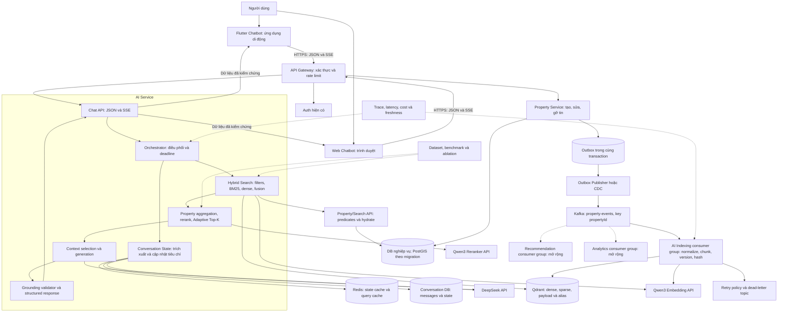
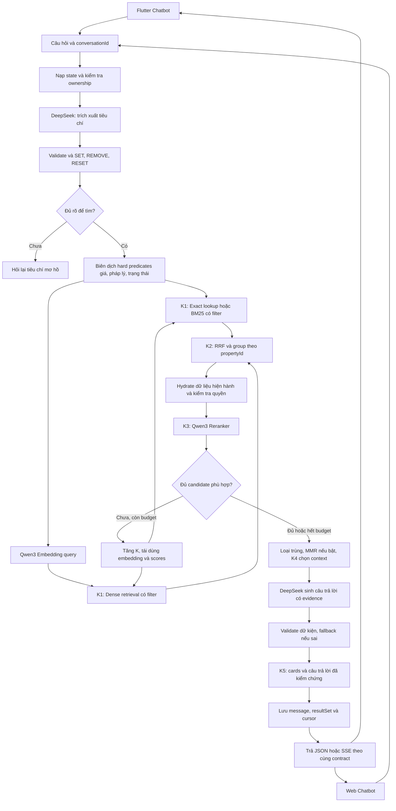
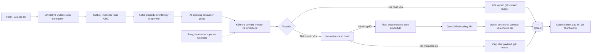

# RESEARCH AI CHATBOT

Cập nhật: 01/11/2026. Phương án triển khai: **DeepSeek API + Qwen3 Embedding API + Qwen3 Reranker API + Qdrant + Kafka**.

Tài liệu phân biệt phần đã có trong mã và phần cần triển khai. Các cấu hình/model/K là ứng viên thực nghiệm, chưa phải kết quả tối ưu. Lần chỉnh này chỉ sửa tài liệu.

## 1. Mục tiêu và phạm vi

Xây dựng chatbot tìm bất động sản bằng tiếng Việt theo **giá, pháp lý, tiêu đề/tên dự án và ngữ cảnh mong muốn tìm nhà**, giữ tiêu chí qua nhiều lượt và trả kết quả có bằng chứng.

Hỗ trợ hai giao diện **Flutter Chatbot** và **Web Chatbot**, dùng chung API, tiêu chí tìm kiếm và dữ liệu hội thoại theo tài khoản.

Trọng tâm khóa luận: hybrid retrieval có bộ lọc nghiệp vụ và Adaptive Multi-stage Top-K. Chunking, conversation state, reranking và đồng bộ index là các thành phần được đánh giá riêng.

## 2. Hiện trạng và các cải tiến cần triển khai

Hiện trạng dựa trên lần đọc mã ngày 01/11/2026, chưa chạy benchmark. Nguồn: `real-estate-ai/rag/pipeline.py`, `api/schemas.py`, `api/routes.py` và Flutter `RagChatService.dart`.

| Nhóm | Đã có trong mã | Cải tiến cần triển khai | Tác dụng |
|---|---|---|---|
| Model API | LLM qua endpoint 9Router cấu hình bằng AI_*; Gemini embedding | DeepSeek và Qwen3 qua API trực tiếp, adapters độc lập | Tách provider khỏi nghiệp vụ, kiểm soát lỗi/chi phí |
| Chunking | Recursive Parent–Child: parent 1.200 ký tự, child 450, overlap 50 | Parent là một property; child theo nhóm trường | Giữ đúng liên kết tiêu đề, giá, pháp lý và tiện ích |
| VectorDB | FAISS và docstore lưu trên đĩa | Qdrant, payload filters, versioning, alias | Lọc có điều kiện, đồng bộ và thay index có kiểm soát |
| Search | Dense retrieval, lọc giá/mua–thuê sau retrieval | Hard filtering + BM25 + dense + RRF | Tìm tên chính xác lẫn ngữ cảnh, giảm tin sai điều kiện |
| Top-K | Fixed k=25 child chunks | Năm tầng Top-K, mở rộng ứng viên trong budget | Điều chỉnh chất lượng/độ trễ/chi phí |
| Ranking | Chưa có reranker chuyên dụng | Qwen3 Reranker, loại trùng; MMR khi có lợi | Xếp lại theo toàn bộ yêu cầu, giảm danh sách lặp |
| Hội thoại | Ghép history, tóm tắt tiêu chí bằng schema | State server với SET/REMOVE/RESET | Cập nhật yêu cầu rõ ràng, không giữ nhầm điều kiện cũ |
| Cập nhật dữ liệu | Nạp Markdown và tái sử dụng index đã lưu | Outbox → Kafka → indexing consumer → upsert/delete | Đồng bộ tin và replay sự kiện trong retention |
| Câu trả lời | Prompt hướng dẫn, text/stream text | Validate dữ kiện, evidence, structured response | Hiển thị đúng property cards và nguồn lý do |
| Đánh giá | Chưa có benchmark được xác nhận | Dataset, baseline, ablation, latency/cost reports | Chứng minh hiệu quả từng cải tiến |

Backend có profile mặc định MySQL và profile production PostgreSQL. PostgreSQL/PostGIS là mục tiêu cần khảo sát migration. Enum đã thấy: PENDING, PUBLISHED, REJECTED, DELETED; quyền hiển thị phải theo policy backend, không chỉ theo enum.

## 3. Kiến trúc mục tiêu

Các sơ đồ dưới đây mô tả **kiến trúc mục tiêu**, không xác nhận mọi thành phần đã triển khai. Các khối trong AI Service là module, không bắt buộc tách thành microservice riêng.

### 3.1. Kiến trúc toàn hệ thống



- DB nghiệp vụ là nguồn chính thức; Qdrant là index có thể xây lại. Outbox cùng DB/transaction với thay đổi property.
- Redis cache state/cache truy vấn; Conversation DB lưu bền vững. Backend kiểm tra quyền sở hữu hội thoại.
- Ba API model có adapter, key, timeout và quota riêng; Flutter Chatbot và Web Chatbot chỉ gọi backend.
- Hai giao diện dùng chung schema response/SSE: filter chips, property cards, lý do, so sánh và xem thêm. Hội thoại theo tài khoản có thể tiếp tục trên thiết bị khác; mỗi request vẫn kiểm tra quyền sở hữu và stateVersion.
- Web cấu hình CORS theo origin được phép và auth theo contract; không nhúng API key provider vào bundle trình duyệt. Flutter cũng không giữ key provider.
- BM25 sparse phải có encoder và policy IDF; collection sparse không tự tạo BM25.
- Auth/Property API tái sử dụng hệ thống hiện có; DB và PostGIS chỉ thay đổi qua migration được kiểm chứng.
- Kafka lưu domain events; mỗi chức năng độc lập dùng consumer group riêng. Recommendation/Analytics là hướng mở rộng; chi tiết lựa chọn Kafka ở mục 8.3.

### 3.2. Luồng tìm kiếm và trả lời



Exact ID/greeting có fast path; không bắt buộc đi qua mọi stage. Nếu hết budget mà không có tin hợp lệ, trả trạng thái không có kết quả/lỗi phụ thuộc rõ ràng; không nới điều kiện hoặc thêm tin không phù hợp. Không phát raw dữ kiện trước validator.

### 3.3. Luồng cập nhật index



Re-index: snapshot watermark → build collection mới → catch-up → verify/benchmark → đổi alias. Index cũ được giữ và cập nhật trong rollback window. Các kiểm soát concurrency/version chi tiết ở mục 8.1.

## 4. Cải tiến chunking

| Kỹ thuật | Cách thực hiện | Lý do dùng |
|---|---|---|
| Property-aware parent | Một tin là một parent theo propertyId | Không cắt xuyên hai bất động sản |
| Field-aware child | Nhóm tiêu đề/vị trí, mô tả, tiện ích, pháp lý | Nội dung mỗi đoạn tập trung vào loại tiêu chí |
| Recursive split | Chỉ chia tiếp nhóm trường quá dài | Giữ kích thước đầu vào hợp lý |
| Parent–Child Retrieval | Tìm child, gom theo propertyId rồi hydrate dữ liệu cha | Tìm chính xác nhưng trả đủ thông tin |

Không chia vụn mọi field; trường ngắn có thể ghép chung. Giá/pháp lý bắt buộc vẫn lọc bằng dữ liệu có cấu trúc. Benchmark **một vector/property**, **Parent–Child hiện tại**, **Field-aware Parent–Child**. Semantic chunking chỉ là thí nghiệm cho tài liệu dài.

## 5. Cải tiến vector database

| Thành phần | Công việc | Kết quả cần đạt |
|---|---|---|
| Qdrant | Lưu named dense/sparse vectors và payload theo chunk | Search service và worker dùng chung index |
| Metadata filtering | Index field giá, giao dịch, loại nhà, vị trí, pháp lý, trạng thái | Mọi nhánh tìm kiếm tuân thủ hard constraints |
| Property version | Lưu phiên bản tin và chặn sự kiện cũ | Không ghi đè bản mới hoặc làm sống lại tin đã gỡ |
| Embedding version | Lưu provider/model/config/dimension/content hash | Không trộn query/document không tương thích |
| Collection alias | Build mới → catch-up → verify → đổi alias | Thay index có kiểm chứng và rollback |

Point ID dùng UUIDv5 ổn định từ propertyId + chunkType + chunkIndex hoặc uint64; không dùng chuỗi tùy ý. Payload tối thiểu gồm `propertyId`, `chunkType`, `chunkIndex`, `content`, `price`, `transactionType`, `propertyTypeId`, `districtId`, `wardId`, `legalStatus`, `legalVerification`, `status`, `propertyVersion`, `embeddingVersion`, `contentHash`.

- Chốt kiểu dữ liệu/payload index cho các trường được lọc; trạng thái và enum ánh xạ theo backend thật.
- Query và document dùng cùng embedding contract: model, dimension, instruction, normalization, preprocessing và truncation.
- Đổi contract không tương thích phải re-index; không fallback sang embedding khác để tìm trên index cũ.
- Collection tách theo nguồn property, location, legal khi các nguồn được triển khai; không tạo mọi collection khi chưa dùng.

## 6. Cải tiến hybrid search và bộ lọc

| Nhu cầu | Kỹ thuật | Quy tắc |
|---|---|---|
| Giá, diện tích, phòng, giao dịch | Structured predicates | Lọc trước ranking; phân biệt đúng/ít nhất/khoảng |
| Pháp lý | Legal status + verification level | Người đăng khai báo khác đã xác minh; UNKNOWN không đạt yêu cầu bắt buộc |
| Tiêu đề, dự án, đường, mã tin | Exact lookup + BM25 | Giữ tên gốc, chuẩn hóa dấu/viết tắt, hỏi lại tên mơ hồ |
| Gia đình, không gian xanh, nhu cầu sống | Dense semantic search | Chỉ là mức liên quan; cần evidence để khẳng định |
| Bán kính và khoảng cách | PostGIS | Tính bằng dữ liệu tọa độ; không để LLM tự tính |
| Gộp hai nhánh | RRF baseline; Weighted RRF/DBSF đối chứng | Không cộng trực tiếp raw BM25 và cosine |

Search API sở hữu predicate nghiệp vụ. Tập candidate nhỏ có thể lọc theo ID; tập lớn dùng payload predicates đã ánh xạ. Không lấy ANN toàn bộ rồi post-filter để gọi là pre-filter. Sau retrieval, batch-hydrate và kiểm tra lại giá/trạng thái/quyền từ Property Service; refill trong budget nếu bị loại.

Giá cần currency, TOTAL/PER_M2, kỳ thuê, toán tử và khoảng. “Khoảng 3 tỷ” phải hiển thị khoảng đang hiểu hoặc hỏi lại. Test “2 tỷ rưỡi”, “3t5”, “15 triệu/tháng”, giá thỏa thuận và thiếu giá. Chuẩn hóa vị trí theo danh mục/version, hỗ trợ tên cũ/mới.

## 7. Cải tiến Top-K và reranking

**Qwen3 Reranker thực hiện K3, không thay K1/K2/K4/K5.** Bản đầu chỉ có một reranker; không xếp nhiều model rerank nối tiếp khi chưa có bằng chứng cần thiết.

| Tầng | Công việc | Cấu hình thử ban đầu |
|---|---|---|
| K1 Retrieval | Dense + BM25 dưới hard filters | 50/50 → 100/100 → 200/150 |
| K2 Property fusion | RRF → group propertyId → khử trùng | Tối đa 50 property, giữ bằng chứng child |
| K3 Reranking | Qwen3 Reranker chấm query-state với property document | 50 → 10 property |
| K4 Context | Chọn bằng chứng theo token budget | Ưu tiên 5 property, tối đa 7; thử 3.000 token |
| K5 Output | Chọn danh sách hiển thị, hỗ trợ xem thêm | Tối đa 5 tin/trang |

K và budget phải benchmark; chỉ có 0–2 tin phù hợp thì trả đúng số đó. Gom chunk so sánh max pooling/mean/top-2 weighted; không để tin nhiều chunks tự chiếm ưu thế. Reranker score/RRF không mặc định là xác suất.

Adaptive K ban đầu:

1. Exact ID/greeting có fast path; extract mơ hồ thì hỏi lại.
2. Embed canonical semantic query một lần, lấy ứng viên vòng đầu.
3. Fuse, aggregate, hydrate, rerank; cache score của candidate không đổi.
4. Chỉ tăng K nếu chưa đủ candidate hợp lệ vượt gate tune trên validation.
5. Dừng khi đủ kết quả, hết candidate, đủ 3 vòng hoặc chạm deadline/cost budget.

Sau rerank có thể loại near-duplicates và dùng MMR để cân bằng liên quan/đa dạng. Thử lambda=0,75 như ứng viên, không áp quota dự án/phường khiến mất hết kết quả phù hợp. Personalization và Learning-to-Rank chỉ triển khai khi có impression/interaction đủ chất lượng.

## 8. Cải tiến cập nhật dữ liệu và hội thoại

### 8.1. Cập nhật index

- Transactional Outbox lưu cùng transaction với thay đổi property; publisher hoặc CDC chuyển sự kiện sang Kafka. Không ghi DB và publish Kafka như hai thao tác độc lập không có cơ chế khôi phục; không giả định email outbox hiện có dùng được ngay.
- Event có eventId, propertyId, aggregateVersion, operation, occurredAt, schemaVersion.
- Worker normalize → chunk → embedding phần đổi → upsert/delete. Hash tách nội dung embedding với payload; không embed lại nếu chỉ payload thay đổi.
- Key bằng propertyId và xử lý tuần tự trong partition hoặc kiểm soát concurrency tương đương. Consumer idempotent, chỉ commit offset liên tục đã xử lý thành công; chặn version cũ và giữ tombstone sau delete/unpublish. Không commit vượt bản ghi chưa hoàn tất.
- Xóa chunks dư khi layout đổi; retry/backoff, dead-letter topic, replay và reconcile định kỳ; test duplicate/out-of-order/crash. Xử lý lặp vẫn có thể xảy ra nếu ghi Qdrant thành công nhưng chưa commit offset.
- Re-index dùng snapshot watermark, catch-up/dual-write có kiểm soát, verify count/hash/visibility rồi đổi alias. Index cũ phải được cập nhật hoặc replay trước rollback.

### 8.2. State nhiều lượt

State lưu typed constraints, hard/soft, sourceMessageId, explicit/inferred, confidence theo trường; không coi confidence tự khai là xác suất đã hiệu chuẩn. Patch dùng SET/REMOVE/RESET, stateVersion và requestId chống lặp.

| Hội thoại | Hành vi cần đạt |
|---|---|
| “Tăng lên 4 tỷ” | Thay budget, giữ tiêu chí khác |
| “Bỏ gần trường” | Xóa đúng preference |
| “Chuyển sang thuê” | Kiểm tra lại giá/đơn vị |
| “Căn thứ hai” | Tham chiếu resultSetId đã hiển thị |
| “Xem thêm” | Cursor ổn định gắn state/index version |
| Không có kết quả | Đề xuất điều chỉnh, không tự nới hard constraints |

Server kiểm tra chủ sở hữu conversation; client history không là nguồn trạng thái duy nhất. Phân biệt không có tin, thiếu bằng chứng, kết quả một phần và lỗi dịch vụ.

### 8.3. Lựa chọn Kafka cho backend microservices

**Quyết định:** dùng Kafka cho luồng domain events, thay phương án RabbitMQ trong thiết kế trước. Request tìm kiếm tương tác vẫn dùng HTTP/JSON/SSE; không đưa mọi lời gọi chatbot qua Kafka.

Lợi thế so với cách dùng RabbitMQ classic/quorum queues trong phương án cũ:

| Yêu cầu của dự án | Lợi thế của Kafka | Áp dụng |
|---|---|---|
| Nhiều service đọc cùng sự kiện | Consumer groups có offset độc lập | Indexing, recommendation, analytics đọc cùng property-events |
| Thử index mới hoặc khôi phục consumer | Replay theo offset trong retention | Catch-up collection mới, chạy lại dữ liệu chưa xử lý |
| Xử lý thay đổi cùng bất động sản | Key theo propertyId, thứ tự trong từng partition | Giảm rủi ro update/delete bị xử lý đảo thứ tự |
| Mở rộng indexing | Partition và consumer group cho phép chia tải | Tăng consumer theo partition và quota embedding |
| Mở rộng nghiên cứu | Dùng lại event stream cho pipeline và đo consumer lag | Đánh giá độ trễ đồng bộ, phục hồi, chi phí replay |

Đây là lựa chọn phù hợp với nhu cầu event streaming của dự án, chưa phải kết luận Kafka nhanh hơn hoặc tiết kiệm hơn. RabbitMQ cũng có Streams/Super Streams hỗ trợ log và replay; Kafka không độc quyền các khả năng đó. Nguồn: [Kafka introduction](https://kafka.apache.org/intro/), [Kafka documentation](https://kafka.apache.org/documentation/), [RabbitMQ Streams](https://www.rabbitmq.com/docs/streams).

**Hợp đồng triển khai:**

- Topic đề xuất `property-events.v1`, key=`propertyId`; group indexing `ai-property-indexer-v1`. Payload gồm eventId, aggregateVersion, operation, schemaVersion và dữ liệu cần thiết hoặc nguồn để hydrate. Schema evolution phải tương thích.
- Các replica cùng chức năng dùng chung group để chia tải; chức năng khác dùng group khác. Một group mới dùng để build index riêng không được giành partition với group đang phục vụ index hiện hành.
- Kafka chỉ bảo đảm thứ tự trong partition theo thứ tự ghi, không tự sắp theo business version. Publisher phải giữ thứ tự theo property; thay số partition có kế hoạch vì có thể đổi ánh xạ key. Version checks vẫn bắt buộc.
- Xử lý mặc định theo at-least-once; Kafka transaction không biến HTTP embedding và Qdrant thành một transaction end-to-end. Dùng idempotency/content hash/version ledger, chỉ commit offset sau khi lưu kết quả thành công.
- Retry có backoff, giới hạn và policy lỗi vĩnh viễn. Nếu retry tại chỗ, pause partition có kiểm soát và vẫn duy trì polling/heartbeat theo client; nếu chuyển retry topic, phải xử lý nguy cơ đảo thứ tự bằng version/tombstone. Chỉ commit bản ghi lỗi sau khi handoff sang dead-letter topic đã được xác nhận bền vững và có kế hoạch khắc phục.
- Retention theo cửa sổ khôi phục, dung lượng và dữ liệu cá nhân; replay không khôi phục sự kiện đã hết retention. Full bootstrap lấy snapshot từ DB/Property API rồi catch-up, không phụ thuộc Kafka lưu toàn bộ lịch sử vô hạn. Replay vào index mới phải xử lý sự kiện payload-only bằng snapshot/cache hoặc hydrate đủ dữ liệu gốc.
- Tái dùng embedding theo content hash và embedding contract để replay không gọi API lại vô ích; giới hạn batch/concurrency theo quota provider.
- Chốt partition count, replication, acks, min.insync.replicas và producer idempotence phù hợp độ bền cần thiết. Dev một broker không chứng minh khả năng chịu lỗi production. Cấu hình consumer polling và thời gian xử lý phù hợp độ trễ API.
- Theo dõi consumer lag, tuổi sự kiện chưa xử lý, index freshness, rebalance, dead-letter count, disk/retention và API cost. Test crash sau upsert/trước commit, consumer restart, replay và sự kiện gỡ tin.

Phạm vi lần sửa tài liệu: cập nhật kiến trúc và contract; chưa cài Kafka, chưa thay cấu hình backend hoặc triển khai consumer.

## 9. Cải tiến câu trả lời, giao diện và vận hành

- Structured response có schemaVersion, conversationId, messageId, intent, understoodFilters, properties, reasons/evidence, warnings, cursor và traceId. Flutter Chatbot và Web Chatbot lấy dữ kiện/card từ dữ liệu đã xác thực, không parse text LLM.
- Validator kiểm tra property thuộc candidate set, còn được hiển thị, đúng hard constraints và dữ kiện khớp backend. Sai thì sửa tối đa một lần, sau đó template từ dữ liệu hợp lệ.
- Reason ghi nguồn field/document version và verification level. “Yên tĩnh/đầu tư tốt” không được khẳng định nếu không có evidence. Khoảng cách ghi POI, nguồn và phương pháp; đường chim bay khác thời gian đi lại.
- Chỉ phát dữ kiện đã kiểm chứng. Bản đầu buffer câu trả lời, validate rồi phát; progress có thể hiển thị sớm. Giữ text endpoint cũ đến khi migration được nghiệm thu.
- SSE có eventId/sequence, schemaVersion, terminal/error events, cancel/reconnect và dedup. Cả hai giao diện có filter chips, cards, compare, empty/partial/error và feedback; kiểm thử transport/render riêng trên mobile và trình duyệt.
- JWT, ownership, quyền tại tool boundary, allowlist tools; retrieval là dữ liệu không đáng tin cậy, không thi hành chỉ dẫn trong tin. Hành động thay đổi dữ liệu cần xác nhận theo contract.
- API timeout/deadline, retry giới hạn/backoff/jitter, quota, circuit breaker; embedding lỗi → SQL/BM25, rerank lỗi → fusion, LLM lỗi → template.
- Trace từng stage, p50/p95, lỗi, cost, tokens, cache hit và index lag. Cache gắn visibility/user scope, state, model/config/index version; không cache chéo dữ liệu riêng tư.
- Key backend/secret manager, TLS, PII redaction, retention/xóa hội thoại; loại unsafe deserialization khỏi pipeline mới. Không rebuild/embed toàn bộ dữ liệu mỗi lần app restart.

## 10. Kế hoạch refactor thành module

Đây là layout đề xuất, chưa tạo file. Không chia microservice chỉ để tăng số lượng service; khởi đầu bằng module có interface, tách deployment khi có lý do về tải/quyền sở hữu.

```text
real-estate-ai/
  main.py                         # app factory/lifespan/DI; không embed dữ liệu lúc khởi động
  api/
    routes.py                     # compatibility endpoints hiện có
    chat_routes.py                # API structured và SSE có version
    schemas.py                    # DTO public, export tương thích trong giai đoạn chuyển
    errors.py
  core/
    config.py                     # validate env, timeout, model contract
    logging.py                    # redact secrets/PII, trace
    dependencies.py               # shared async clients, shutdown
  domain/
    constraints.py                # typed predicates, money/legal semantics
    conversation.py               # state/patch/result references
    property.py                   # search document/candidate/evidence
    events.py
  providers/
    protocols.py                  # LLM, Embedding, Reranker interfaces
    deepseek.py
    qwen_embedding.py
    qwen_reranker.py               # HTTP rerank schema riêng
    resilience.py                 # quota, retry, circuit breaker
  conversation/
    extractor.py
    reducer.py                     # deterministic SET/REMOVE/RESET
    repository.py                  # PostgreSQL/Redis theo contract
  ingestion/
    sources.py                    # Markdown baseline, Property API target
    normalizer.py
    chunkers.py
    worker.py
    reconciliation.py
    migrations.py                 # rebuild/catch-up/alias plan
  search/
    property_client.py            # canonical search/hydration
    vector_store.py               # Qdrant adapter
    lexical.py                    # BM25 adapter
    fusion.py
    aggregation.py
    adaptive_k.py
  ranking/
    rerank.py
    scoring.py
    dedup.py
    diversity.py
  generation/
    prompts.py
    context_builder.py
    grounding.py
    responder.py
  orchestration/
    chat.py                       # assemble stages, deadline, degraded mode
  rag/
    pipeline.py                   # facade tạm thời cho caller cũ
  scripts/                        # CLI quản lý index và kiểm tra kết nối
  evaluation/                     # dataset manifest, runners, reports
  tests/                          # unit, contract, integration, regression
```

Quy tắc phụ thuộc: API → orchestration → domain/interfaces; provider adapters không biết Flutter; domain không phụ thuộc FastAPI/LangChain/Qdrant. Prompts versioned, DTO request/response tách internal state; không cho routes gọi thẳng SDK. Async I/O, tái sử dụng clients; tác vụ CPU/blocking chạy worker/thread phù hợp. Liveness không phụ thuộc provider, readiness có chính sách degraded rõ ràng.

Refactor theo hai bước riêng: (1) characterisation/regression và di chuyển mã giữ hành vi; (2) sửa lỗi nghiệp vụ có test trước/sau. Không đóng băng các lỗi đọc budget cũ, suy giao dịch từ ngưỡng 100 triệu, hoặc UNKNOWN price lọt hard filter thành hành vi đích. Giữ facade/API legacy đến khi client mới nghiệm thu; không xóa baseline và index cũ trước khi có kết quả so sánh.

## 11. Setup Qdrant, DeepSeek và Qwen3 API

### 11.1. Phạm vi và profile nhà cung cấp

Hướng dẫn được đối chiếu nguồn chính thức ngày 01/11/2026. Model/endpoint/quota có thể thay đổi; xác minh lại trong console bằng tài khoản thật trước triển khai. Chưa có key nên chưa xác nhận quyền truy cập, thanh toán, tiếng Việt hoặc latency thực tế.

| Thành phần | Profile API minh họa | Ghi chú |
|---|---|---|
| LLM | DeepSeek: `deepseek-flash` | Non-thinking baseline; Pro là đối chứng |
| Embedding | SiliconFlow: `Qwen/Qwen3-Embedding-8B` | Có trong ví dụ API chính thức; không đồng nghĩa bắt buộc chọn 8B |
| Reranker | SiliconFlow: `Qwen/Qwen3-Reranker-8B` | API `/rerank` riêng, không dùng chat để thay rerank |
| Embedding thay thế | Alibaba Model Studio: `text-embedding-v4` | Thuộc Qwen3-Embedding; không mặc định là checkpoint 0.6B/4B/8B tương thích |

Chọn profile SiliconFlow để có ví dụ API cho đúng cả hai dòng Qwen3. Bản 0.6B/4B chỉ đưa vào benchmark khi tài khoản/provider có endpoint thực sự; không giả lập tên model. Bản 8B là ứng viên API, không phải kết luận chất lượng/chi phí tối ưu. Provider embedding và rerank có thể khác nhau; thay reranker không cần re-embed, thay embedding không tương thích thì cần.

Nguồn cấu hình: [DeepSeek models](https://api-docs.deepseek.com/quick_start/pricing/), [thinking](https://api-docs.deepseek.com/guides/thinking_mode/), [SiliconFlow embedding](https://docs.siliconflow.com/en/api-reference/embeddings/create-embeddings), [SiliconFlow rerank](https://docs.siliconflow.com/en/api-reference/rerank/create-rerank), [Alibaba embedding](https://www.alibabacloud.com/help/en/model-studio/text-embedding-synchronous-api).

### 11.2. Chuẩn bị và cấu hình key

1. DeepSeek: tạo tài khoản ở [API Platform](https://platform.deepseek.com/), kiểm tra billing/quota, tạo key cho backend.
2. SiliconFlow: vào [website chính thức](https://www.siliconflow.com/), mở console từ website, tạo key, kiểm tra quyền gọi đúng hai model, giá và giới hạn input/batch.
3. Không dùng key DeepSeek cho Qwen. Một key SiliconFlow có thể được cấp quyền cho hai tác vụ nhưng cấu hình hai biến riêng để dễ tách quota/key.
4. Dùng env/session hoặc secret manager. Nếu dùng `.env` local, bảo đảm được ignore; `.env.example` chỉ chứa placeholder. Không in key, commit key, ghi key vào Flutter/Web hoặc dán vào prompt.

Mẫu **cấu hình mục tiêu**, chưa được mã hiện tại đọc; Cần tạo config loader trước khi dùng cho ứng dụng:

```dotenv
LLM_API_BASE_URL=https://api.deepseek.com
LLM_MODEL=deepseek-flash
LLM_API_KEY=REPLACE_LOCALLY
LLM_THINKING=disabled
EMBEDDING_API_BASE_URL=https://api.siliconflow.com/v1
EMBEDDING_MODEL=Qwen/Qwen3-Embedding-8B
EMBEDDING_API_KEY=REPLACE_LOCALLY
EMBEDDING_VERSION=qwen3-api-v1
RERANK_API_BASE_URL=https://api.siliconflow.com/v1
RERANK_MODEL=Qwen/Qwen3-Reranker-8B
RERANK_API_KEY=REPLACE_LOCALLY
QDRANT_URL=http://127.0.0.1:6333
QDRANT_COLLECTION=property_chunks_v1
QDRANT_ALIAS=property_chunks_current
PROVIDER_TIMEOUT_SECONDS=30
PROVIDER_MAX_RETRIES=2
```

`QDRANT_API_KEY` được cấp riêng khi dùng Qdrant Cloud hoặc server bật auth. Sau smoke embedding mới ghi `EMBEDDING_DIMENSION` từ vector trả về và đóng băng trong manifest; không đoán số chiều từ tên model để tạo collection. Trong Docker network, dùng service hostname thay localhost. Mapping biến cũ `AI_*`/`GOOGLE_API_KEY` chỉ giữ ở legacy profile, không fallback ngầm sang gateway.

### 11.3. Chạy Qdrant local hoặc dùng Cloud

Chọn một trong hai cách. Qdrant local vẫn cần Docker Desktop chạy Linux containers. Ví dụ PowerShell, chỉ chạy sau khi chọn tag Qdrant đã kiểm tra tương thích; không ghi đè container hiện hữu:

```powershell
docker version
$env:QDRANT_IMAGE_TAG = Read-Host 'Nhap tag Qdrant da kiem tra'
if ([string]::IsNullOrWhiteSpace($env:QDRANT_IMAGE_TAG)) { throw 'Can tag cu the' }
docker volume create realestate_qdrant_data
docker run -d --name realestate-qdrant --restart unless-stopped -p 127.0.0.1:6333:6333 -v realestate_qdrant_data:/qdrant/storage "qdrant/qdrant:$env:QDRANT_IMAGE_TAG"
Invoke-RestMethod -Uri 'http://127.0.0.1:6333/collections'
```

Local smoke dùng loopback, không phải cấu hình public production. Dashboard: [localhost](http://127.0.0.1:6333/dashboard). REST dùng 6333; chỉ mở gRPC 6334 nếu adapter cần. Nếu container cùng tên đã tồn tại, kiểm tra và dùng `docker start realestate-qdrant`; không tự xóa volume.

Cloud: tạo cluster trong [Qdrant Cloud](https://cloud.qdrant.io/), lấy HTTPS cluster URL và key; cấu hình QDRANT_URL/QDRANT_API_KEY. Snapshot/restore và kiểm thử khôi phục phải có trước production. Nguồn: [Qdrant quickstart](https://qdrant.tech/documentation/quickstart/), [cloud](https://qdrant.tech/documentation/cloud-quickstart/).

### 11.4. Kiểm tra API trước tích hợp

Các đoạn Python dưới đây là mẫu độc lập, chưa có file script trong repo. Sau khi đặt env thật, có thể chạy trong môi trường Python tạm; Cần đóng gói thành `scripts/provider_smoke.py`. Cài `openai`, `httpx`, `qdrant-client` vào môi trường cô lập và chốt phiên bản đã test trong dependency lock.

Ví dụ chuẩn bị môi trường smoke riêng bằng PowerShell, không sửa requirements của app hiện tại. Các phiên bản được cài ở đây chỉ để thử kết nối; dependency lock tích hợp được tạo sau kiểm thử:

```powershell
Set-Location 'D:/RealEstateMobile-Project/real-estate-ai'
py -3.12 -m venv .venv-ai-smoke
.\.venv-ai-smoke\Scripts\python.exe -m pip install openai httpx qdrant-client
```

Nhập key vào env phiên hiện tại mà không ghi trực tiếp vào lịch sử lệnh (lặp cho EMBEDDING_API_KEY và RERANK_API_KEY). Mẫu này không nạp `.env` tự động; đặt các env không bí mật theo mẫu 11.2 trước khi chạy Python:

```powershell
$taskSecret = Read-Host 'DeepSeek API key' -AsSecureString
$env:LLM_API_KEY = [System.Net.NetworkCredential]::new('', $taskSecret).Password
Remove-Variable taskSecret
$env:LLM_API_BASE_URL = 'https://api.deepseek.com'
$env:LLM_MODEL = 'deepseek-flash'
$env:EMBEDDING_API_BASE_URL = 'https://api.siliconflow.com/v1'
$env:EMBEDDING_MODEL = 'Qwen/Qwen3-Embedding-8B'
$env:RERANK_API_BASE_URL = 'https://api.siliconflow.com/v1'
$env:RERANK_MODEL = 'Qwen/Qwen3-Reranker-8B'
$env:QDRANT_URL = 'http://127.0.0.1:6333'
$env:QDRANT_COLLECTION = 'property_chunks_v1'
$env:QDRANT_ALIAS = 'property_chunks_current'
```

Lưu từng đoạn Python mẫu thành file tạm ngoài Git rồi chạy bằng `.\.venv-ai-smoke\Scripts\python.exe <duong-dan-file.py>`. Phần tạo collection phải chạy trong cùng script với embedding smoke hoặc nhận dimension từ manifest đã kiểm chứng; không chạy độc lập khi chưa có biến `vector`.

DeepSeek smoke (tốn quota nhỏ, chỉ dùng dữ liệu giả):

```python
import os
from openai import OpenAI

client = OpenAI(api_key=os.environ['LLM_API_KEY'],
                base_url=os.environ['LLM_API_BASE_URL'],
                timeout=30, max_retries=0)
r = client.chat.completions.create(
    model=os.environ['LLM_MODEL'],
    messages=[{'role': 'user', 'content': 'Tra loi ngan: xin chao.'}],
    max_tokens=80,
    extra_body={'thinking': {'type': 'disabled'}},
)
assert r.choices[0].message.content
print({'model': r.model, 'has_answer': True})
```

Không mặc định temperature=0 bảo đảm tính xác định. Kiểm tra JSON/schema, tool calling và tiếng Việt bằng contract suite riêng; smoke chỉ chứng minh kết nối và một phản hồi.

Qwen embedding smoke; không tự thêm instruction hoặc `dimensions` nếu provider chưa xác nhận hỗ trợ:

```python
import os
import httpx

r = httpx.post(
    os.environ['EMBEDDING_API_BASE_URL'].rstrip('/') + '/embeddings',
    headers={'Authorization': 'Bearer ' + os.environ['EMBEDDING_API_KEY']},
    json={'model': os.environ['EMBEDDING_MODEL'], 'input': ['Can ho gan truong hoc']},
    timeout=30,
)
r.raise_for_status()
data = r.json()
vector = data['data'][0]['embedding']
assert vector and all(isinstance(x, (int, float)) for x in vector)
print({'dimension': len(vector), 'model': data.get('model')})
```

Kiểm tra số chiều, finite values, thứ tự `index` khi batch, cách xử lý query/document và truncation; pin cấu hình sau khi thử. Mọi document/query dùng cùng embedding contract. Nếu chọn Alibaba: tạo key đúng vùng/workspace, lấy base URL hiện hành từ console, dùng model `text-embedding-v4`; dùng collection riêng, không tái dùng index SiliconFlow.

Qwen rerank smoke:

```python
import os
import httpx

documents = ['Can ho 2 phong ngu gan truong hoc', 'Nha xuong trong khu cong nghiep']
r = httpx.post(
    os.environ['RERANK_API_BASE_URL'].rstrip('/') + '/rerank',
    headers={'Authorization': 'Bearer ' + os.environ['RERANK_API_KEY']},
    json={'model': os.environ['RERANK_MODEL'], 'query': 'Tim nha cho gia dinh co con nho',
          'documents': documents, 'top_n': 2},
    timeout=30,
)
r.raise_for_status()
results = r.json()['results']
assert results and all(0 <= item['index'] < len(documents) for item in results)
print([{'index': x['index'], 'score': x['relevance_score']} for x in results])
```

Map index trả về với candidateId của input; không dùng text LLM tự sinh làm ID. Validate index duy nhất, finite score và số kết quả. Smoke không chứng minh thứ hạng tốt trên tiếng Việt; cần benchmark có nhãn.

### 11.5. Khởi tạo collection sau khi biết dimension

Mẫu Python độc lập sau embedding smoke (biến `vector` là vector vừa nhận); chỉ tạo mới, không xóa collection đã có. Pin client/server version và kiểm tra schema hiện hữu trước tái sử dụng:

```python
import os
from qdrant_client import QdrantClient, models

q = QdrantClient(url=os.environ['QDRANT_URL'], api_key=os.getenv('QDRANT_API_KEY'))
name = os.environ['QDRANT_COLLECTION']
q.create_collection(
    collection_name=name,
    vectors_config={'dense': models.VectorParams(size=len(vector), distance=models.Distance.COSINE)},
    sparse_vectors_config={'sparse': models.SparseVectorParams()},
)
q.create_payload_index(name, field_name='propertyId', field_schema=models.PayloadSchemaType.INTEGER)
q.create_payload_index(name, field_name='status', field_schema=models.PayloadSchemaType.KEYWORD)
q.create_payload_index(name, field_name='price', field_schema=models.PayloadSchemaType.FLOAT)
q.update_collection_aliases(change_aliases_operations=[
    models.CreateAliasOperation(create_alias=models.CreateAlias(
        collection_name=name, alias_name=os.environ['QDRANT_ALIAS']))
])
```

Mẫu chỉ tạo schema và alias ban đầu; chưa nạp dữ liệu, chưa hoàn tất mọi payload index. Alias production chỉ chuyển sau quality gates. Field type phải khớp payload thực tế; yêu cầu các index còn lại ở mục 5. Khai báo sparse vector không tự tạo BM25: cần triển khai encoder/tokenizer, corpus/IDF policy và kiểm tra parity. Không gọi full-text filter là BM25 ranking.

### 11.6. Chính sách vận hành API

- Một deadline toàn request, timeout từng stage, semaphore theo provider, quota theo user; retry có jitter và budget chung, tôn trọng Retry-After. Không retry lỗi auth/schema; không retry mù sau stream đã phát dữ liệu.
- Embedding lỗi → SQL/BM25 degraded; rerank lỗi → fusion; LLM lỗi → template từ dữ liệu đã xác thực. Không đổi embedding model trên index cũ.
- Cache key gồm normalized query + state/predicate + visibility scope + model/config/index version; không chia cache dữ liệu riêng tư giữa user. Có TTL/invalidation theo freshness.
- Đo chi phí query, ingestion và re-index riêng; số request, tokens, retries, cache hits, đơn giá theo ngày. Chốt hạn mức trước batch benchmark lớn.

## 12. Chương trình nghiên cứu đủ mở rộng cho các khóa luận

Hệ thống dùng chung data contract, dataset và benchmark; mỗi nhánh chọn giả thuyết riêng. Phạm vi lớn không đồng nghĩa phải hoàn thành mọi thuật toán trong cùng một khóa luận.

| Nhánh | Câu hỏi nghiên cứu | Baseline/đối chứng | Bằng chứng chính |
|---|---|---|---|
| R1 Chunking/representation | Field-aware parent-child có tốt hơn một vector/property không? | Fixed-size, parent-child hiện tại | Property Recall/nDCG, evidence coverage, storage/cost |
| R2 Hybrid/geo | Lexical + semantic cải thiện truy vấn giá/pháp lý/tên dự án/ngữ cảnh ra sao? | Structured-only, dense-only, BM25, RRF | nDCG, constraint violations, slice tiếng Việt |
| R3 Adaptive Top-K | Có giữ chất lượng với ít chi phí/latency hơn Fixed K không? | Fixed K thấp/cao, oracle offline | Quality-cost Pareto, p95, expansion count |
| R4 Conversation | State reducer và clarification giảm lỗi đổi tiêu chí không? | Câu cuối, ghép history, summary hiện tại | Slot F1, state exact match, task completion |
| R5 Ranking/diversity | Rerank/MMR tăng phù hợp và độ đa dạng bao nhiêu? | Fusion-only, rerank-only | nDCG, duplicate rate, diversity, cost |
| R6 ANN/index optimization | HNSW/filter selectivity/dimension/quantization ảnh hưởng thế nào? | Exact vector search, cấu hình mặc định | ANN recall so với exact, RAM, disk, throughput/p95 |
| R7 Index consistency | Incremental indexing giảm độ trễ cập nhật mà vẫn đúng dữ liệu không? | Full rebuild, batch sync | Freshness lag, stale/deleted result rate, recovery time |

R1–R5 phục vụ thuật toán tìm kiếm/hội thoại; R6–R7 phục vụ tối ưu hệ thống. Đề xuất khóa luận hiện tại chọn R2 + R3 làm trọng tâm, R1/R4 là thành phần bắt buộc được đánh giá; các nhánh còn lại triển khai có giới hạn hoặc chuyển hướng phát triển.

Các cải tiến đề xuất thêm: query routing exact/lexical/semantic để giảm gọi API; spell/alias normalization có kiểm soát; clarification theo tiêu chí gây giảm candidate mạnh nhất; negative feedback; geo-aware ranking; cost-aware context selection. Query expansion/HyDE chỉ thực nghiệm sau baseline, không được đổi hard constraints hoặc đưa nội dung giả vào dữ liệu hiển thị.

### 12.1. Quy trình benchmark

1. Đóng băng snapshot property/POI/visibility và thời điểm đánh giá; qrels ở cấp property, nhãn graded 0–3 với hướng dẫn hard constraints và UNKNOWN.
2. Dùng pooled candidates từ nhiều hệ thống, có kiểm tra bổ sung; không coi mọi tài liệu chưa chấm là không liên quan. Tính Recall với phạm vi nhãn được công bố.
3. Chia train/validation/test theo nhóm hội thoại, near-duplicate property và khi phù hợp theo thời gian; không để các lượt cùng hội thoại rơi vào hai tập. Tune trên validation, test giữ kín.
4. Hai người chấm một phần giao nhau, đo agreement và phân xử; LLM judge chỉ hỗ trợ, không là nguồn chân lý duy nhất.
5. Báo cáo theo slice: giá, pháp lý, title/entity, ngữ nghĩa, đa lượt, không có kết quả, tên địa điểm mơ hồ, typo/không dấu, adversarial.
6. Cùng snapshot/model/prompt cho ablation, thay từng thành phần. So Adaptive/Fixed K với cùng budget và tính đủ retries/API calls; tune từng nhóm tham số trước khi thử kết hợp, tránh tìm kiếm toàn bộ tổ hợp tốn phí.
7. Đo cold/warm cache, concurrency, timeout/error, p50/p95, paired bootstrap confidence interval và nhiều lần chạy khi API không xác định. ANN recall và business relevance recall là hai chỉ số khác nhau.
8. Lưu manifest: dataset hash, qrels version, code revision/dirty diff hash, config, dependency lock, provider/model/time, seed, collection/index watermark và đơn giá. Công bố giới hạn alias model upstream.
9. Interaction logging phải có impression, rank, exposure và consent; không xem “không click” là negative chắc chắn. Personalization/LTR chỉ bật sau đủ dữ liệu và đánh giá bias.

### 12.2. Quality gates

Correctness gates bắt buộc: không lộ tin không được phép xem; không trả tin sai hard constraints trong bộ test xác định; unknown legal/price không vượt qua yêu cầu bắt buộc; không lẫn chủ sở hữu conversation; không resurrect tin sau delete; không trộn embedding contract.

Mục tiêu định lượng về nDCG/slot F1/latency/chi phí phải được chốt sau pilot baseline và lưu trước test cuối. Không điền số “đạt 95%” khi chưa đo. Mục tiêu nghiên cứu có thể là non-inferiority về nDCG với biên chốt trước, đồng thời giảm p95/cost; kết quả không cải thiện vẫn phải báo cáo. Có regression suite, fault injection giả lập 429/timeout/duplicate/out-of-order và end-to-end UI; không gọi API tính phí trong unit test.

## 13. Lộ trình nghiệm thu thực tế

1. **Audit và contract:** khảo sát schema/API thật, tạo dataset pilot 100 query và hội thoại chuyển tiêu chí; quyết định DB migration riêng, chốt budget API.
2. **Refactor và providers:** tách module theo mục 10; legacy không hỏng; smoke endpoint/model/dimension có evidence hoặc ghi blocked rõ ràng.
3. **Dữ liệu và index:** kết nối dữ liệu nghiệp vụ và Qdrant; ingest fixture rồi dữ liệu được phép; visibility, ordering, update/delete, reconcile và rebuild được kiểm chứng.
4. **Search baseline:** triển khai và so sánh SQL/BM25/dense/hybrid cùng snapshot và cùng predicates. Flutter Chatbot và Web Chatbot chạy với fixture theo cùng API contract.
5. **Hội thoại và grounding:** hoàn thiện state patch, no-match, result references, validated output và compatibility E2E.
6. **Thuật toán tối ưu:** thực nghiệm rerank, MMR, Adaptive K và chunking ablation, báo cả quality/latency/cost.
7. **Đóng gói khóa luận:** tổng hợp bằng chứng, sơ đồ hiện trạng/mục tiêu, bảng kết quả, giới hạn và hướng R1–R7. Chỉ ghi đã triển khai/đạt khi có mã và kết quả tương ứng.

Observability, privacy, rate-limit, redaction và security regression bắt đầu từ bước 2, không đợi giai đoạn nâng cao. Không bắt buộc đưa mọi nhánh nghiên cứu vào bản đầu.

## 14. Checklist trước khi tuyên bố sẵn sàng

- [ ] Contract ánh xạ schema/DB/enum/visibility thật, target profile chỉ gọi trực tiếp các API đã chọn.
- [ ] Key backend được bảo vệ, đúng provider/region; model/dimension/rerank schema được smoke kiểm tra.
- [ ] Refactor giữ legacy API; lifecycle không khởi tạo index tốn phí mỗi lần restart.
- [ ] Chunk theo đúng property, vector/payload version rõ, update/delete/out-of-order/crash có test.
- [ ] Kafka topic/key/group, Outbox publisher, offset commit, retention, retry/dead-letter và replay được kiểm chứng; không lặp embedding ngoài budget.
- [ ] Hard filters áp dụng nhất quán mọi nhánh và hydrate lại trước trả về.
- [ ] State thêm/sửa/xóa/reset, ownership, result reference, cursor và request dedup có test.
- [ ] Rerank/MMR/Adaptive K có ablation, budget và fallback; không dùng score như xác suất vô căn cứ.
- [ ] Structured/SSE có version, không phát dữ kiện chưa kiểm chứng, client xử lý lỗi và cancel.
- [ ] Dataset/split/qrels/manifest, ANN-vs-exact và business metrics được phân biệt.
- [ ] Dashboard/trace/cost/freshness, backup/restore và rollback index có evidence.
- [ ] Báo cáo triển khai ghi lệnh kiểm tra, kết quả và giới hạn thực tế.

Tất cả checkbox đang để trống có chủ đích: đây là tiêu chí nghiệm thu, không phải kết quả thực thi.
